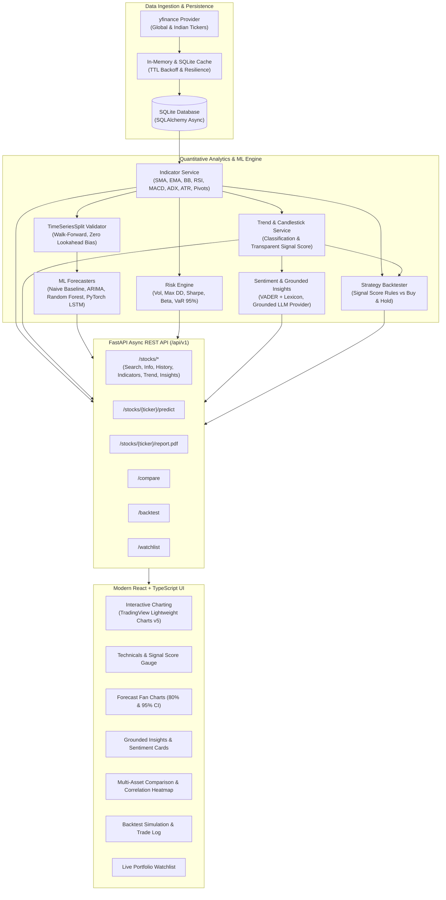

# MarketLens AI 📈🤖
### Quantitative Stock Market Analytics, Machine Learning Forecasting & Risk Intelligence Engine

[](https://www.python.org/)
[](https://fastapi.tiangolo.com/)
[](https://react.dev/)
[](https://www.typescriptlang.org/)
[](https://pytorch.org/)
[](https://tailwindcss.com/)
[](https://opensource.org/licenses/MIT)

> **IMPORTANT DISCLAIMER**: **MarketLens AI is strictly an educational and analytical research platform. It is NOT financial advice, an investment recommendation, or a solicitation to buy or sell securities.** All forecasts and scores represent probabilistic mathematical evaluations based on historical price data. Financial markets involve substantial risk of capital loss.

---

## 🏛️ System Architecture



---

## ✨ Core Features & Capabilities

### 1. Interactive Technical Dashboard
- **TradingView Lightweight Charts v5**: High-performance interactive candlestick chart with volume histogram and timeframe selectors (1M, 3M, 6M, 1Y, 5Y, Max).
- **Overlays on Demand**: SMA (20, 50, 200), EMA (20, 50, 200), Bollinger Bands ($\pm 2\sigma$), and Support/Resistance Pivot Levels (Standard Classic).
- **Oscillator Sub-Charts**: Tabbed indicators for Wilder's 14-period RSI, MACD (12, 26, 9) with histogram momentum, and Stochastic Oscillator (%K, %D).
- **Global & Indian Market Support**: Seamless lookups for US equities (`AAPL`, `TSLA`, `NVDA`), Indian equities (`RELIANCE.NS`, `TCS.NS`, `INFY.NS`), and indices (`^NSEI`, `SPY`).

### 2. Quantitative Trend Engine & Transparent Signal Score
- **Multi-Factor Trend Classification**: Identifies primary trends (Strong Uptrend, Uptrend, Sideways/Consolidation, Downtrend, Strong Downtrend) utilizing MA alignment, ADX trend strength, and 30-day linear regression slope.
- **Pattern Recognition**: Automated detection of Doji, Hammer, Inverted Hammer, Bullish/Bearish Engulfing, and Morning/Evening Stars.
- **100% Transparent Signal Score (-100 to +100)**: Unlike "black-box" trading scores, every point is completely decomposed across 6 weighted categories:
  - Moving Average Alignment ($\pm 25\%$)
  - RSI Momentum ($\pm 20\%$)
  - MACD Acceleration ($\pm 20\%$)
  - ADX Trend Strength & Direction ($\pm 15\%$)
  - Bollinger Bands Position ($\pm 10\%$)
  - Candlestick Patterns ($\pm 10\%$)

### 3. Machine Learning Prediction & Zero-Leakage Validation
- **Engineered Lag Features**: Strictly backward-looking technical lags (returns, rolling volatility, RSI, MACD hist, BB %B).
- **Walk-Forward TimeSeriesSplit**: Zero future lookahead bias, zero random shuffling, and strict chronological training splits.
- **Ensemble of Forecasters**:
  - **Naive Persistence Baseline**: $y_{t+h} = y_t$ (the benchmark every ML model must beat).
  - **ARIMA**: Statistical autoregressive integrated moving average with confidence intervals.
  - **Random Forest**: Non-linear ensemble with bootstrap prediction variance.
  - **PyTorch LSTM**: Deep 2-layer recurrent neural network with dropout and PyTorch CPU optimization.
- **Honest Model Reliability Rating**: Computes MAE, RMSE, MAPE, and Directional Accuracy %. If a model fails to beat the Naive baseline, the UI prominently displays an **"Underperforming Baseline"** warning with full transparency.

### 4. Grounded AI Market Insights & News Sentiment
- **Strictly Grounded Analytical Reports**: Insights are generated using computed metrics (RSI, ADX, moving averages, Sharpe, forecast price) passed directly into the reasoning engine. No hallucinated prices.
- **Financial News Sentiment**: VADER NLP engine augmented with a specialized financial lexicon (`surge`, `slump`, `rally`, `plummet`, `headwinds`, `stellar`) to score recent news articles and display a visual sentiment breakdown gauge.

### 5. Multi-Asset Comparison & Risk Engine
- **Normalized Relative Return Chart**: Rebases 2 to 5 equities to 0% at common inception to directly compare trajectories over time.
- **Institutional Risk Table**: Side-by-side Annualized Volatility, Maximum Drawdown (MDD), Sharpe Ratio ($R_f = 4.5\%$), Beta vs benchmark index (`SPY` or `^NSEI`), and 1-Day 95% Historical Value at Risk (VaR).
- **Pearson Return Correlation Heatmap**: 2D pairwise correlation matrix highlighting portfolio diversification opportunities.

### 6. Quantitative Strategy Backtester
- **Signal Score Simulation**: Simulates entering long positions when Signal Score $\ge +20$ and exiting when Score $\le -10$.
- **Equity Curve vs Buy & Hold**: Compares compounded account growth against the benchmark, reporting CAGR %, Max Drawdown %, Sharpe Ratio, Win Rate %, Profit Factor, and average trade return %.
- **Full Trade Audit Log**: Detailed trade ledger tracking entry/exit dates, execution prices, shares, dollar PnL, return %, and hold periods.

### 7. Institutional PDF Export
- Generates publication-grade research reports (`GET /api/v1/stocks/{ticker}/report.pdf`) built with ReportLab, featuring price tables, technical indicators, ML forecast cones, AI insights, and mandatory educational disclaimers.

### 8. Portfolio Watchlist
- SQLite-backed watchlist tracking real-time prices, 24-hour deltas, and live Signal Score conviction badges.

---

## 🛠️ Technology Stack

| Layer | Technologies |
|---|---|
| **Frontend** | React 19, Vite, TypeScript, Tailwind CSS, Lucide Icons, TradingView Lightweight Charts v5, Recharts, TanStack Query, React Router v7 |
| **Backend** | Python 3.11, FastAPI, Pydantic v2, SQLAlchemy 2.0 (Async), Uvicorn, Tenacity |
| **Machine Learning** | PyTorch 2.1+ (CPU), Scikit-Learn, Statsmodels (ARIMA), Pandas, NumPy, SciPy |
| **NLP & Reporting** | VADER Sentiment, ReportLab 5.1 |
| **Database** | SQLite via `aiosqlite` & `greenlet` |
| **Testing** | Pytest, Pytest-Asyncio, HTTPX, Vitest, React Testing Library, JSDOM |
| **DevOps & Containers** | Docker, Docker Compose, Nginx (Alpine) |

---

## 🚀 Quickstart & Installation

### Option 1: Docker Compose (Recommended - Single Command)

Ensure you have [Docker](https://www.docker.com/) and Docker Compose installed:

```bash
# 1. Clone repository
git clone https://github.com/your-username/marketlens-ai.git
cd marketlens-ai

# 2. Copy environment file
cp .env.example .env

# 3. Launch application stack
docker compose up --build
```

- **Frontend**: `http://localhost` (or `http://localhost:5173` in dev)
- **FastAPI Documentation**: `http://localhost:8000/docs`
- **Health Check**: `http://localhost:8000/health`

---

### Option 2: Local Development Setup

#### Prerequisites
- **Python 3.11+**
- **Node.js 20+** & npm

#### 1. Backend Setup
```bash
# Navigate to backend and create virtual environment
cd "backend"
python -m venv venv

# Activate virtual environment
# Windows:
venv\Scripts\activate
# Linux/macOS:
source venv/bin/activate

# Install PyTorch CPU and Python dependencies
pip install torch --index-url https://download.pytorch.org/whl/cpu
pip install -r requirements.txt

# Launch FastAPI development server with auto-reload
cd ..
uvicorn backend.app.main:app --host 127.0.0.1 --port 8000 --reload
```

#### 2. Frontend Setup
```bash
# In a new terminal:
cd "frontend"

# Install npm packages
npm install

# Start Vite development server
npm run dev
```

Open `http://localhost:5173` in your browser.

---

## 🧪 Testing Suite

### Backend Unit & Integration Tests (27 Tests)
Run the complete backend test suite covering mathematical indicator accuracy, no-leakage time-series validation, ARIMA/LSTM forecasters, risk engine, and watchlist CRUD:

```bash
# Windows
& "backend\venv\Scripts\python.exe" -m pytest backend/tests -v

# Linux/macOS
pytest backend/tests -v
```

### Frontend Component Tests (Vitest + RTL)
Run frontend unit tests validating UI rendering, disclaimers, and interactive widgets:

```bash
cd frontend
npm run test
```

### Production Build Verification
```bash
cd frontend
npm run build
```

---

## 📡 API Reference Overview

All endpoints are versioned under `/api/v1`:

| Method | Endpoint | Description |
|---|---|---|
| `GET` | `/stocks/search?q=` | Autocomplete ticker and company name search |
| `GET` | `/stocks/{ticker}/info` | Company fundamentals, currency, 52W high/low |
| `GET` | `/stocks/{ticker}/history?range=&interval=` | Historical OHLCV candlestick bars |
| `GET` | `/stocks/{ticker}/indicators?range=` | Snapshot and time-series of SMA, EMA, BB, RSI, MACD, etc. |
| `GET` | `/stocks/{ticker}/trend` | Primary trend classification and transparent Signal Score |
| `POST` | `/stocks/{ticker}/predict` | Machine learning price forecast with confidence intervals |
| `GET` | `/stocks/{ticker}/sentiment` | News headline sentiment polarity scores and distribution |
| `GET` | `/stocks/{ticker}/insights` | Strictly grounded AI executive summary and catalysts |
| `GET` | `/stocks/{ticker}/report.pdf` | Downloadable institutional research report PDF |
| `POST` | `/compare` | Multi-asset normalized returns and Pearson correlation matrix |
| `POST` | `/backtest` | Signal Score strategy simulation vs Buy & Hold |
| `GET` | `/watchlist` | Retrieve all saved watchlist assets with live prices and scores |
| `POST` | `/watchlist` | Add a stock symbol to the watchlist |
| `DELETE`| `/watchlist/{ticker}` | Remove a stock symbol from the watchlist |

Interactive OpenAPI Swagger UI is accessible at `http://localhost:8000/docs`.

---

## 🧠 Machine Learning Methodology

### Preventing Data Leakage
Financial time series exhibit non-stationarity, autoregression, and temporal dependence. Standard randomized $K$-fold cross-validation results in catastrophic lookahead bias (training on tomorrow to predict yesterday). 

MarketLens AI enforces:
1. **Strict Lag Features**: Features at time $t$ use only observations from $t-1, t-2, \dots, t-k$.
2. **Expanding Window Walk-Forward Validation**: Using `TimeSeriesSplit`, training sets always precede test sets chronologically.
3. **Naive Benchmark Protocol**: Every model is tested against a naive martingale random-walk baseline:
   $$\hat{y}_{t+h} = y_t$$
   If an ML model fails to achieve an RMSE lower than the naive baseline, it is explicitly flagged as underperforming in the UI.

---

## ⚖️ Legal & Educational Disclaimer

> **PLEASE READ CAREFULLY**:
>
> 1. **Not Financial Advice**: MarketLens AI is engineered exclusively for educational, quantitative research, and exploratory purposes. Nothing within this platform constitutes financial, tax, or investment advice.
> 2. **No Warranties**: Financial markets are subject to macroeconomic unpredictability, liquidity shocks, and extreme volatility. Algorithmic outputs, technical indicators, and machine learning predictions are probabilistic approximations, not guarantees.
> 3. **Risk Warning**: Trading in equities, foreign exchange, derivatives, and commodities involves high risk and may result in the loss of your entire capital. Always consult a licensed financial advisor before making investment decisions.

---

## 📄 License
This project is licensed under the [MIT License](LICENSE).
